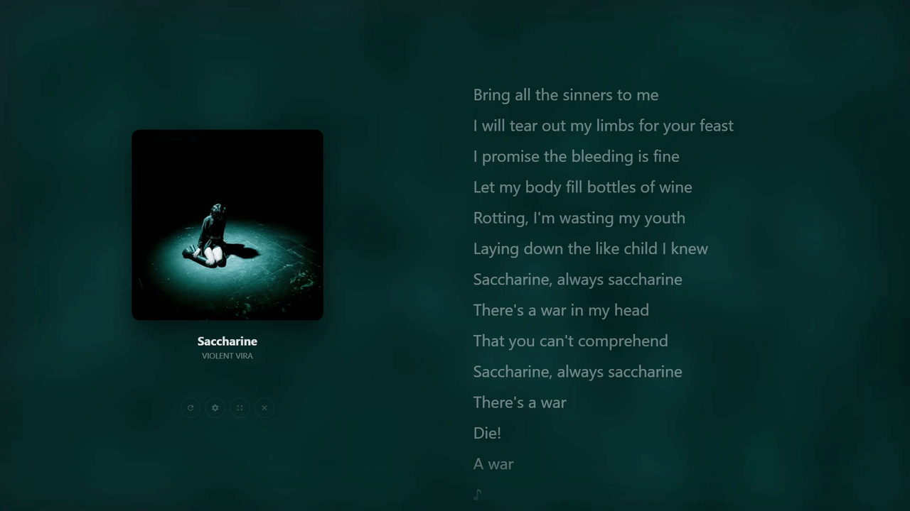
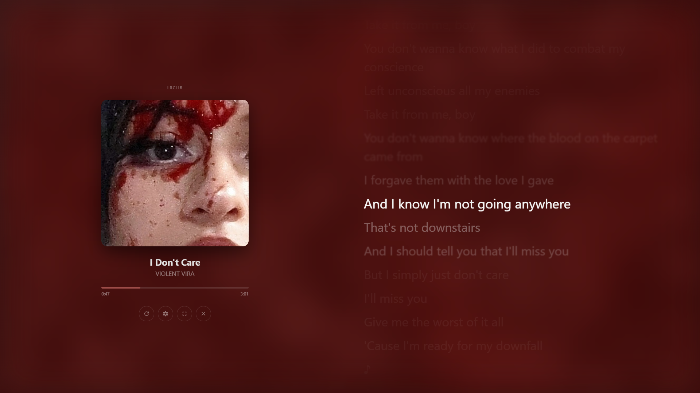
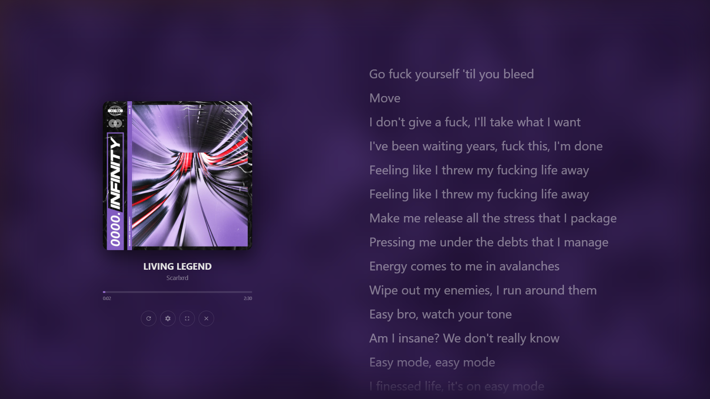
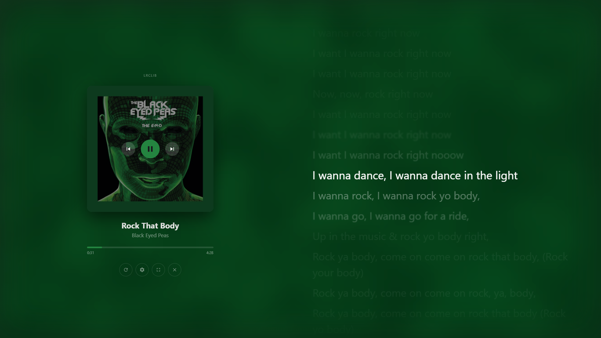

<div align="center">


# aura

**Synced lyrics for any Windows player**

[](LICENSE)
[](https://github.com/neccuryy/aura/releases)
[](https://github.com/neccuryy/aura/releases)

[🇷🇺 Читать на русском](README.ru.md)

<p align="center"></p>

</div>

---

aura listens to whatever is playing on your machine — any player that reports
to Windows **SMTC** (System Media Transport Controls): Yandex Music, browsers,
Spotify, AIMP, foobar2000… — finds the lyrics and highlights the current line
in real time, the way Yandex Music does.

## Features

- **Works with any player** — reads the system media session; no per-player integration, no hooks into the player process
- **Complete lyrics pipeline** — local `.lrc` → [Lrclib](https://lrclib.net) (synced) → [Genius](https://genius.com) (plain), with strict title/artist/duration matching
- **Real-time highlighting** — the active line grows and brightens, neighbors blur; smooth auto-scroll; click any line to seek
- **Live alignment** *(dev builds for now)* — when only plain lyrics exist, aura syncs them itself while the song plays: vocals are isolated from the system audio with classic DSP and lines are placed with dynamic programming — no neural networks, no model downloads
- **Palette from the album art** — background, accents and even the title bar recolor to match the cover
- **Everything is cached** — lyrics, misses and alignments; replays are instant, and a track listened to once starts synced the next time
- **Auto-update** via GitHub Releases

## Install

Grab the latest installer from **[Releases](https://github.com/neccuryy/aura/releases)** and run it.

Or run from source (Node.js, Windows):

```bash
npm install
npm start
```

## Screenshots

<p align="center">
<table>
  <tr>
    <td></td>
    <td></td>
    <td></td>
  </tr>
  <tr align="center">
    <td>Synced lyrics — the active line highlighted, palette from the cover</td>
    <td>50/50 layout — cover, metadata, controls</td>
    <td>Synced lyrics from Lrclib — source badge above the cover</td>
  </tr>
</table>
</p>

---

## Lyrics sources

The full search chain, from most precise to online fallbacks:

1. **Local `.lrc`** — a file with timings sitting next to the mp3 (or in any indexed folder). The name must match the mp3: `1. track.mp3` → `1. track.lrc`. Enhanced LRC, multiple timestamps per line and UTF-8/UTF-16/cp1251 encodings are supported.
2. **[Lrclib](https://lrclib.net)** — a free, token-less database of synced lyrics. An exact query first (title + artist + duration), then search with scoring: a matching title is required, artist and duration add weight. Returns **synced** lyrics → full per-line highlighting.
3. **[Genius](https://genius.com)** — for tracks missing from Lrclib. Plain text (no timings): dev builds align it live (see below), release builds show it as-is. Requires a Client Access Token (see [Configuration](#configuration)).
4. Nothing found — a tidy placeholder.

While the search runs you get a loader. The **"wrong lyrics"** button (the ✕ on the side) drops the cached verdict and re-searches in strict mode (exact title match).

**Source switcher:** when a track has several sources (local `.lrc`, Lrclib, Genius, an aura alignment), arrows `‹ name ›` appear above the cover and cycle through them. A manually picked source keeps the screen until the track changes.

**Cache:** verdicts and misses are cached in `%APPDATA%\aura\lyrics` — replays are instant. A miss is only cached when both services answered a definitive "no"; network errors never poison the cache. aura alignments land here too (see below).

## Live alignment (dev-only for now)

When only plain lyrics are available (Genius, plain Lrclib text, an unsynced local `.lrc`), aura turns them into synced lyrics itself — while the song plays:

- **System audio capture** (WASAPI loopback): it hears exactly what the player actually outputs, with any player
- **Vocal isolation without neural nets**: mid/side stereo split (vocals sit dead center in a mix), a 300–3400 Hz speech band, and a VAD with an adaptive noise-floor threshold
- **DP alignment**: lines are matched to vocal segments with a two-pass dynamic program (blocks → lines), guided by onset anchors and a tempo estimate from envelope autocorrelation
- **Live re-solving** every 5 seconds as evidence accumulates; passed lines with a stable binding freeze (Anchor Locking) — the highlight never jumps back into played text
- **Cache**: when the track ends, the result passes a quality gate (listen completion, vocal coverage, DP cost, monotonicity) and is cached as the "aura" source — the next play starts synced. A genuine synced verdict (Lrclib) is never overwritten

This path is currently disabled in packaged builds — dev runs only (`npm start`).

## Covers

- SMTC artwork shows instantly
- If the system art is small (<480px), a 512px version is fetched in the background from the iTunes Search API / Deezer
- **Strict matching** of title and artist — a "wrong song" cover is never accepted
- Cover cache: `%APPDATA%\aura\covers` (auto-wiped when the cache format version changes)

## Interface

- 50/50 layout: cover + metadata + controls on the left, lyrics on the right; everything scales with the window (`clamp()`, viewport units)
- **Palette from the cover** — background, accents and even the native title bar recolor to the artwork (node-vibrant)
- Player buttons (⏮ ▶ ⏭) over the cover on hover, seek bar with scrubbing
- Hamburger menu (☰): music folders, lyrics cache (size + clear), Genius token, source ignore list, fullscreen
- The window drags by its top zone; the native title bar is hidden and recolored to the palette
- Fullscreen (F11), Escape closes the menu

## Configuration

File: `%APPDATA%\aura\config.json`

```json
{
	"musicFolders": ["D:\\Music"],
	"geniusToken": "your-client-access-token"
}
```

| Field | Purpose |
|---|---|
| `musicFolders` | Folders to index for mp3 + `.lrc` (indexed in the background) |
| `geniusToken` | Genius Client Access Token — from the [API clients page](https://genius.com/api-clients) ("Generate Access Token"). Only needed for the Genius fallback; without it the chain is `.lrc` → Lrclib |
| `ignoredApps` | SMTC sources aura should ignore (messengers with voice messages etc.). Managed from settings, the "Ignore" section |

Folders are usually added via the UI: menu ☰ → "Music folders".

## How it works

```
┌───────────────────────── Processes ─────────────────────────┐
│                                                            │
│  Player (Yandex Music / browser / …)                       │
│    ├─ SMTC (Windows)                                       │
│    │    └─ winplayer-node (native addon, N-API)            │
│    └─ system audio: WASAPI loopback (dev)                  │
│         └─ native capture (aura_loopback)                  │
│              └─ Electron main (TypeScript)                 │
│                   ├─ DSP: vocals → VAD segments (dev)      │
│                   ├─ DP alignment of lyric lines (dev)     │
│                   ├─ .lrc library (music-metadata)         │
│                   ├─ Lrclib API → Genius API + scraping    │
│                   ├─ covers: iTunes / Deezer (sharp)       │
│                   └─ palette (node-vibrant)                │
│                        └─ IPC (contextIsolation + preload) │
│                             └─ Renderer (HTML/CSS/JS)      │
└────────────────────────────────────────────────────────────┘
```

- The **main process** polls SMTC every 500 ms (a single serialized loop — native calls never run in parallel), tracks song/status changes and runs the online searches with stale-response protection.
- The **renderer** has no build step: plain HTML/CSS/JS talking to main only through the `window.aura` bridge (preload, `contextIsolation: true`).
- **winplayer-node** is a native C++ addon (N-API, ABI-stable), patched locally (`patches/winplayer-node/`): a mutex around session state, an active-session snapshot, the callback strictly outside the lock, a position capture timestamp. The patches fix a race that crashed the process.

### Sources

```
src/
├── main/                  # Electron main (TypeScript → dist/)
│   ├── index.ts           # entry point: window, IPC, SMTC poll loop
│   ├── watcher.ts         # winplayer-node wrapper (serialized calls)
│   ├── loopback.ts        # WASAPI loopback: system audio capture (dev)
│   ├── dsp.ts             # DSP: mid/side, speech band, VAD segmentation
│   ├── align.ts           # DP alignment of lines to vocal segments
│   ├── calibrate.ts       # per-track VAD threshold calibration
│   ├── library.ts         # folder indexing: mp3 ↔ .lrc
│   ├── lrc.ts             # .lrc parser (+ BOM/UTF-16/cp1251 decoding)
│   ├── lrclib.ts          # Lrclib API + the shared lyrics cache
│   ├── genius.ts          # Genius API (search) + page scraping
│   ├── cover.ts           # covers: iTunes/Deezer, strict matching, cache
│   ├── palette.ts         # palette extraction from the cover
│   ├── config.ts          # config.json (folders, geniusToken)
│   ├── updater.ts         # auto-update via GitHub Releases
│   └── preload.ts         # window.aura bridge
└── renderer/              # UI (no build step)
    ├── index.html
    ├── style.css
    ├── fluid-bg.js        # WebGL fluid background in cover colors
    └── app.js             # lyrics rendering, highlighting, scroll, menu
```

## Development

Requires Node.js, Windows; VS Build Tools + Python to rebuild the native addon.

```bash
npm install                 # postinstall rebuilds native dependencies
npm start                   # compile + run in dev mode
npm run compile             # TypeScript only (tsc -b)
node test-title-match.js    # unit test for title matching (cover.ts)
node benchmark.js           # alignment benchmark on the corpus from musicFolders
node benchmark.js --compare # diff of the two latest runs
```

### Building the exe

```bash
npm run build               # compile + electron-builder (nsis + zip → targets/)
```

> The build rebuilds native dependencies from the patched sources in `node_modules` — the `patches/winplayer-node/` patches land in the build automatically.

## App data

Everything lives in `%APPDATA%\aura`:

| Path | Contents |
|---|---|
| `config.json` | settings (folders, Genius token) |
| `lyrics/` | lyrics cache (found `.json` + miss markers `.miss`) |
| `covers/` | cover cache (auto-wiped on cache format version change) |
| `crashes/` | crash dumps (native addons) |

## License

MIT
